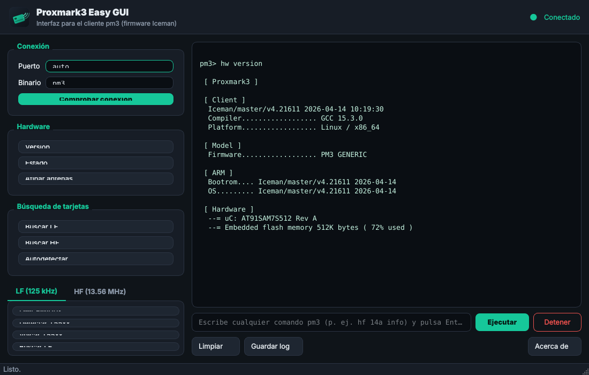

# Proxmark3 Easy GUI

Interfaz gráfica de escritorio, ligera y en español, para manejar un **Proxmark3 Easy** con el **firmware Iceman** desde Kali Linux (u otra distro).

No reemplaza ni modifica tu instalación: por debajo llama al cliente oficial
`pm3` (`pm3 -c "<comando>"`), así que **cualquier cosa que funcione en la
consola `pm3` funciona aquí igual**. Es simplemente una capa visual cómoda
encima del cliente que ya tienes.



## Características

- **Panel de conexión**: elige el puerto (`auto` o `/dev/ttyACM0`) y el binario, y comprueba el estado con un clic (indicador verde/rojo en la cabecera).
- **Botones de acciones rápidas** para lo más habitual, sin memorizar comandos:
  - Hardware: *Versión*, *Estado*, *Afinar antenas* (`hw tune`).
  - Búsqueda: *Buscar LF*, *Buscar HF*, *Autodetectar*.
  - Pestaña **LF (125 kHz)**: leer EM410x, detectar/volcar T55xx.
  - Pestaña **HF (13.56 MHz)**: info ISO14443-A, info MIFARE, info MFU/NTAG.
- **Consola integrada**: ejecuta *cualquier* comando `pm3` que escribas, con la salida en tiempo real.
- **Detener** un comando en curso, **limpiar** y **guardar el log** a un fichero.
- Tema oscuro, icono propio y acceso directo en el escritorio.

## Requisitos

- **Cliente Proxmark3 (Iceman)** ya instalado y funcionando (`pm3` en el PATH).
  En Kali: `sudo apt install proxmark3`. El firmware del dispositivo debe
  coincidir con el del cliente (si no, la propia GUI te mostrará el aviso de
  *version mismatch* que da `pm3`).
- **Python 3** (3.8 o superior).
- **PyQt5**. En Kali lo más sencillo: `sudo apt install python3-pyqt5`
  (el instalador puede hacerlo por ti, o crear un entorno virtual con pip).

## Instalación

```bash
git clone https://github.com/MyNameIsMarkel/proxmark3-easy-GUI.git
cd proxmark3-easy-GUI
./install.sh
```

El script `install.sh`:
1. Comprueba Python y PyQt5 (ofrece instalarlo por apt o en un venv local).
2. Avisa si no encuentra el cliente `pm3`.
3. Registra el icono y crea el acceso directo en el **menú de aplicaciones** y
   en el **Escritorio** (detecta `Escritorio`/`Desktop` automáticamente).

## Cómo iniciar la aplicación

Tienes tres formas, todas equivalentes:

- **Icono del Escritorio** o entrada en el menú de aplicaciones (tras `install.sh`).
- **Lanzador**: `./run.sh`
- **Módulo de Python**: `python3 -m pm3gui`

> El Proxmark necesita acceso al puerto serie. Si no ejecutas como `root`,
> asegúrate de que tu usuario está en el grupo `dialout`
> (`sudo usermod -aG dialout $USER`, y vuelve a iniciar sesión).

## Uso rápido

1. Conecta el Proxmark3 Easy por USB.
2. Abre la app y pulsa **Comprobar conexión** (ejecuta `hw version`). El punto
   de la cabecera se pondrá verde si todo va bien.
3. Pon una tarjeta sobre la antena y usa **Buscar LF** / **Buscar HF**, o
   escribe el comando que quieras en la caja inferior.

## Limitaciones y notas importantes

- Es un **envoltorio** del cliente `pm3`: no añade capacidades nuevas al
  Proxmark, solo facilita el acceso a las existentes. Si `pm3` no funciona en
  terminal, la GUI tampoco lo hará.
- Los comandos se ejecutan de forma **no interactiva** (`pm3 -c "…"`): se lanza
  el comando, se muestra su salida y el proceso termina. Flujos que requieren
  responder a preguntas interactivas dentro de `pm3` no están pensados para
  esta versión.
- Se ejecuta **un comando cada vez** (con botón *Detener* para abortarlo).
- Pensado y probado para **Linux** (Kali). En otros sistemas puede requerir
  ajustes.
- **Uso responsable**: utiliza la herramienta únicamente con tarjetas,
  credenciales y dispositivos de tu propiedad o para los que tengas permiso
  explícito. El clonado o manipulación de credenciales ajenas (transporte,
  control de accesos, pago, documentos) puede ser ilegal.

## Desinstalar

```bash
./uninstall.sh
```

Elimina el acceso directo y el icono. El código y el entorno virtual `.venv`
permanecen en la carpeta del repositorio (bórrala a mano si quieres).

## Licencia

MIT — ver [LICENSE](LICENSE).
